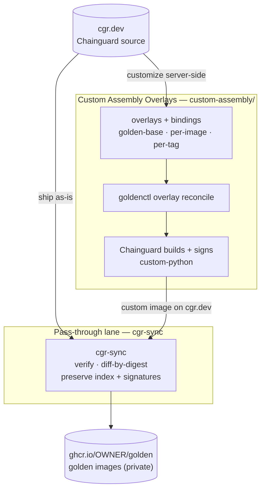
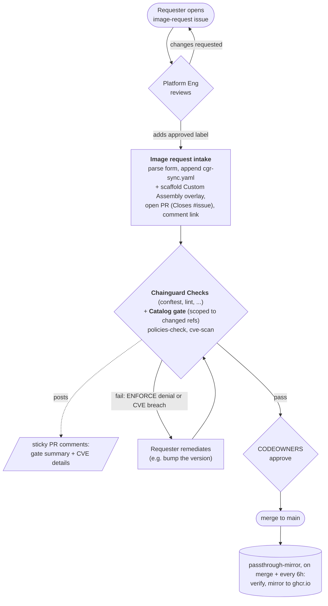

# Chainguard Golden Images Pipeline Example

## Contents

- [Goals](#goals)
- [Non-Goals](#non-goals)
- [Pipeline overview](#pipeline-overview)
  - [1. Custom Assembly Overlays — custom-assembly/](#1-custom-assembly-overlays--custom-assembly)
  - [2. Pass-through lane — cgr-sync.yaml + .github/workflows/passthrough-mirror.yaml](#2-pass-through-lane--cgr-syncyaml--githubworkflowspassthrough-mirroryaml)
  - [Which lane?](#which-lane)
- [Policy status dashboard](#policy-status-dashboard)
- [Governance — managing & gating requests and releases](#governance--managing--gating-requests-and-releases)
  - [1. Request → auto-PR](#1-request--auto-pr)
  - [2. Gate (on the PR)](#2-gate-on-the-pr)
  - [3. Registry pull policies (enforced by Chainguard, at pull time)](#3-registry-pull-policies-enforced-by-chainguard-at-pull-time)
  - [4. Library pull policies (Chainguard Libraries — Java / npm / Python)](#4-library-pull-policies-chainguard-libraries--java--npm--python)
  - [5. Release (recommended: gate the promotion)](#5-release-recommended-gate-the-promotion)
  - [Demo flow](#demo-flow)
- [Repository layout](#repository-layout)
  - [Workflows (.github/workflows/)](#workflows-githubworkflows)
- [Required secrets](#required-secrets)
- [To Do](#to-do)
- [Custom Assembly (custom-assembly/)](#custom-assembly-custom-assembly)
  - [Prerequisites](#prerequisites)
- [Runbook — common tasks](#runbook--common-tasks)
  - [Pre-create the golden packages (private)](#pre-create-the-golden-packages-private)
  - [Add a pass-through image (mirror as-is)](#add-a-pass-through-image-mirror-as-is)
  - [Mirror an image the org isn't entitled to (public catalog)](#mirror-an-image-the-org-isnt-entitled-to-public-catalog)
  - [Customize **all** custom images](#customize-all-custom-images)
  - [Customize **one** image](#customize-one-image)
  - [Add a brand-new custom image](#add-a-brand-new-custom-image)
  - [Rotate / replace the internal CA](#rotate--replace-the-internal-ca)
  - [Change the locale (or other base env/packages)](#change-the-locale-or-other-base-envpackages)
  - [Upgrade cgr-sync](#upgrade-cgr-sync)
  - [CVE gate waivers (not VEX)](#cve-gate-waivers-not-vex)
  - [Verify failures](#verify-failures)


## Goals

- Demonstrate an ingestion pipeline for Chainguard images into a Golden Images repository
- Assume a Platform Engineer perspective
- Demonstrate best practices — server-side customization via Custom Assembly, signature verification before mirroring, and preserving upstream signatures/attestations

## Non-Goals

- Not all-encompassing; this is a "what could be" example of a potential pipeline

## Pipeline overview

Two complementary lanes feed the golden-images registry (private GitHub Container Registry packages under `ghcr.io/<owner>/golden/`). Customization happens **server-side** with Chainguard Custom Assembly (no derived Dockerfiles), and everything reaches the registry through the `cgr-sync` pass-through mirror:



### 1. Custom Assembly Overlays — `custom-assembly/`

For images that need modification (extra packages, certificates, annotations). Chainguard assembles and **signs** the customized image server-side from **overlays**: a shared base layer, a per-image layer, and optional per-tag layers (for example `-dev` only) — there's no derived Dockerfile to maintain, and the customization is captured in the image's provenance. See the [Custom Assembly](#custom-assembly-custom-assembly) section below.

### 2. Pass-through lane — `cgr-sync.yaml` + `.github/workflows/passthrough-mirror.yaml`

Mirrors images **as-is** from `cgr.dev` into the registry with [`cgr-sync`](https://github.com/cartyc/image-syncer) — including the Custom Assembly images built above:

- Preserves the **multi-arch index** and the **upstream cosign signatures / attestations**.
- **Verifies** each image's signature before copying (Chainguard's signing identity; Custom Assembly images use the org's build identity — see `cgr-sync.yaml`).
- **Diffs by digest** — only copies what's missing or changed, so re-runs are cheap.
- Adding an image is a one-line entry in `cgr-sync.yaml`.
- **Pushes only to packages that already exist and are private.** Before anything is pushed, `goldenctl catalog guard` checks every destination package; the run stops if one is missing, public, or not granted to this repository (see [the registry](#the-registry-private-ghcrio-packages)).
- After mirroring, a **`verify` job independently checks each golden image in the registry**: a `grype` CVE scan (fails on `critical` by default — set the `GRYPE_FAIL_ON` variable to adjust) plus a `cosign verify-attestation` SBOM check, reusing the per-image identities from `cgr-sync.yaml`. A catalog ref that isn't in the registry after the mirror fails `verify` too.

Runs every 6h, on every push to `main` that changes `cgr-sync.yaml` (so a merged catalog change mirrors straight away), and on manual dispatch. A `custom-assembly/**` change doesn't trigger it: Chainguard rebuilds the Custom Assembly images server-side, and the next scheduled or manual run mirrors the new digests.

#### The registry: private ghcr.io packages

Images land at `ghcr.io/<owner>/golden/<image>` (for example `ghcr.io/cartyc/golden/python`). Set the `DEST_REGISTRY` repository variable to use another prefix; the workflow lowercases it, because OCI repository names must be lowercase. Both jobs log in with the built-in `GITHUB_TOKEN`: the `mirror` job has `packages: write` and the `verify` job `packages: read`. There is no registry credential to store or rotate.

- **The workflow must never create a package.** This repository is public, and GitHub documents that when a workflow creates a package with `GITHUB_TOKEN`, "the package inherits the visibility and permissions model of the repository where the workflow is run" ([Publishing and installing a package with GitHub Actions](https://docs.github.com/en/packages/managing-github-packages-using-github-actions-workflows/publishing-and-installing-a-package-with-github-actions#default-permissions-and-access-settings-for-packages-modified-through-workflows)). So a package the mirror creates comes out **public**, and a public package can't be made private again. The first ghcr run did exactly that. The "private by default" rule only covers packages first pushed some other way, such as from your machine.
- **So the packages are pre-created by hand, as private**, and the mirror only updates them: see [Pre-create the golden packages (private)](#pre-create-the-golden-packages-private). The mirror job's guard (`goldenctl catalog guard`) runs before any push and fails if a destination package is missing, public, or can't be read with the job's token.
- **How the guard checks.** The GitHub packages REST API, which reports `visibility`, needs a personal access token (classic); `GITHUB_TOKEN` can't call it. So the guard asks the registry instead, which needs no extra secret. An **anonymous** tags request succeeds only for a public package. A request with the job's `GITHUB_TOKEN` returns `404` for a missing package and `401`/`403` for one this repository has no access to. Any other answer fails the guard.
- **Package access.** Each package grants this repository **Write** under **Manage Actions access**, which covers both the mirror and `verify`. cgr-sync copies images byte for byte, so it can't add the `org.opencontainers.image.source` label that would link a package to this repository. GitHub warns that "if you grant a public repository access to private packages, forks of the repository may be able to access the private packages". This repository's pull-request workflows could pull the golden images, so keep **Settings → Actions → General → Approval for running fork pull request workflows** on **Require approval for all external contributors**.
- **Pulling.** Consumers such as clusters need a token with the `read:packages` scope (for example an image pull secret).
- **Cost.** GitHub's [billing docs](https://docs.github.com/en/billing/concepts/product-billing/github-packages) say Container registry storage and bandwidth are currently free, with at least a month's notice before that changes.

### Which lane?

| The image… | Lane |
| --- | --- |
| needs extra packages, certs, or other modification | **Custom Assembly** (built + signed by Chainguard) |
| ships unmodified | **pass-through** |

Either way the image lands in the golden registry (ghcr.io) via the pass-through mirror.

## Policy status dashboard

A GitHub Pages dashboard shows, at a glance, **what's enforcing vs dry-run**, a
**golden-catalog enforcement matrix** (which policy allows/denies each image),
**recent denials**, and **recent pipeline runs** (pass/fail). It refreshes on a
schedule and whenever the mirror / policy workflows finish — so it reflects the
current picture "as builds pass and fail."

- Built by `.github/workflows/policy-dashboard.yml` from `goldenctl dashboard`
  (reads `chainctl policies binding list` / `check` / `decision list`, all read-only).
- Preview the page locally: `goldenctl dashboard --mock && open site/index.html`.
- **One-time setup:** repo **Settings → Pages → Source = GitHub Actions**. It then
  publishes to `https://<owner>.github.io/golden-image/`.

## Governance — managing & gating requests and releases

The catalog above is *what* ships; this section is *how a change gets in*. The
golden registry is run as a **governed service**: every request is reviewed and
gated before promotion, and the registry itself enforces policy at pull time.



> DRY_RUN policy denials show as **warnings** in the gate (they don't block);
> only **ENFORCE** denials and CVE-threshold breaches fail the PR.

### 1. Request → auto-PR
A team opens a **Golden image request** issue (`.github/ISSUE_TEMPLATE/image-request.yml`)
— image, pinned tag, lane, FIPS need, owner, justification. Platform Engineering
reviews and adds the **`approved`** label; the **Image request intake** workflow
(`.github/workflows/image-request-intake.yml`) then parses the form, appends the
`cgr-sync.yaml` entry (and, for the Custom Assembly lane, scaffolds a
`custom-assembly/overlays/<repo>.yaml` overlay stub and binds it), opens the PR `Closes`-ing the
issue, and comments the PR link back — so **no one hand-edits YAML**. Prefer to
author the PR yourself? `goldenctl catalog add --name <repo> --tags <t1,t2>`
appends a valid entry the same way.

> One-time setup: create an `approved` label. To make the bot-opened PR trigger
> Catalog gate immediately (a PR opened with the default `GITHUB_TOKEN` doesn't
> trigger other workflows), provide **one** of: a **GitHub App** (secrets
> `INTAKE_APP_ID` + `INTAKE_APP_PRIVATE_KEY`, recommended — short-lived token
> scoped to this repo) or a fine-grained **`INTAKE_PAT`** (contents +
> pull-requests write). Without either, the PR still opens; gates run on the
> first human push.

### 2. Gate (on the PR)
- **CODEOWNERS** (`.github/CODEOWNERS`) — Platform Engineering must approve any
  change to the catalog, overlays, or policies. Enforce with branch protection
  ("Require review from Code Owners").
- **Required check: Chainguard Checks (presubmit)** — the only status check
  the `main` ruleset requires. It covers lint, `goldenctl` tests and `conftest`
  (`policy/conftest/`): the request is well-formed and within policy, meaning
  sources on `cgr.dev`, packages on the approved allowlist, HTTPS runtime
  repos and signatures verified. Demo a denial:
  `conftest test --policy policy/conftest policy/conftest/examples/disallowed-package.yaml`.
  It also runs `catalog-exists` and `cve-scan` on PRs that get the `cgr-pull`
  identity; see [Chainguard Checks](#chainguard-checks-and-workspaces-chainguard).
- **Catalog gate** (`.github/workflows/catalog-gate.yml`), on every catalog PR whoever opened it:
  - `chainctl policies check` (`goldenctl gate policies`) — the image passes
    the **registry's** active pull policies. An **ENFORCE** denial fails the PR
    (a non-compliant image is never promoted); a **DRY_RUN** denial is a
    *warning* only, so observe-mode policies inform the reviewer without
    blocking.
  - `cve-scan` (`goldenctl gate cve`) — `grype` scans the image and fails the
    PR if its Critical/High CVE counts exceed the thresholds
    (`MAX_CRITICAL`/`MAX_HIGH`, default `0`/`0`; `MAX_MEDIUM` unlimited). Pull
    policies can't see CVEs — their input is package lifecycle metadata only —
    so this scanner step is the actual **CVE-count** gate. Tune the thresholds
    in the workflow `env:` and in the `cve-scan` `vars:` of
    `.chainguard/ci/repo.yaml`; keep the two the same.
    A CVE with no fix yet can be waived for named images, for at most 30 days,
    in `policy/cve-exceptions.yaml`: see
    [CVE gate waivers](#cve-gate-waivers-not-vex).
  - Both checks are **scoped to the refs the PR changed** (`goldenctl catalog changed`),
    so a request is judged on its own change, not the whole catalog's
    pre-existing state. Whole-catalog coverage still runs via the scheduled
    **passthrough-mirror** verify job and a manual **Catalog gate** dispatch
    (which scan everything).
- **Gate feedback (sticky PR comments)** — the Catalog gate posts a **summary**
  comment (pass/fail for both of its checks) and, when `cve-scan` fails, an
  itemized **CVE-details** comment (offending CVE · package · installed ·
  fixed-in) so the requester sees exactly what to fix without reading job logs.
  Both auto-update on each push.
- **Validate** / **Validate catalog** — actionlint with shellcheck + the source-exists check.

### 3. Registry pull policies (enforced by Chainguard, at pull time)
Independently of CI, the org registry enforces **pull-time** policy — see
[`registry-policies/`](registry-policies/README.md). Custom Rego policies here:
`fips-required`; plus system policies (`no-eol`, `cooldown`, `support-window`).
Both the definitions *and their activation* are
codified: `registry-policies/bindings.yaml` declares which policies are enabled,
their mode (`DRY_RUN`/`ENFORCE`) and parameters (reconciled by
`goldenctl policy bindings`). Everything starts in `DRY_RUN`; review
`chainctl policies decision list`, then flip a binding to `ENFORCE` in
`bindings.yaml`. Exceptions are per-digest, attributable **overrides**.

### 4. Library pull policies (Chainguard Libraries — Java / npm / Python)
The same request→gate→apply→observe→enforce pattern for **language
dependencies** — see [`library-policies/`](library-policies/README.md). These
are **declarative** (not Rego): Chainguard applies **cooldown + malware/greyware**
gates automatically, and a policy here adds an explicit **blocklist** (by purl,
optionally pinned to a bad `@version`) plus **justified allow exceptions**.
Activated per ecosystem (`--ecosystem JAVA|JAVASCRIPT|PYTHON`) in `PREVIEW`,
then `ENFORCE`. Reconciled by `goldenctl policy libraries` via the
**Policies** workflow.

**Unblock requests (self-service).** When an enforced gate blocks a pull, a
developer files a **Library unblock request** issue
(`.github/ISSUE_TEMPLATE/library-unblock.yml`) — ecosystem, package coordinate,
optional version, what's blocking it, and a justification. Platform Engineering
reviews and adds the **`approved`** label; the **Library unblock intake**
workflow (`.github/workflows/library-unblock-intake.yml`) then edits
`golden-libraries.yaml` — adding an `allow` exception with the right
cooldown/malware overrides (and dropping a matching `block` line) — and opens a
PR `Closes`-ing the issue. Same review + apply path as any policy change; no
hand-edited YAML. Mirrors the image-request intake in [§1](#1-request--auto-pr).

### 5. Release (recommended: gate the promotion)
The mirror is timer/manual today. For a human **release gate**, run promotion
through a protected GitHub **Environment** so an approver signs off before an
image lands in the golden registry:

```yaml
# on the mirror/promote job — add required reviewers to this environment in repo settings
environment: golden-prod
```

Pair with a **staging -> prod** promote (mirror to a `-staging` repo, verify,
then gated promote to prod) for the canonical two-tier release control.

### Demo flow
1. Open an **image request** issue for `python:3.13 + bash,curl`.
2. PR -> show a **policy failure** (add `nmap` -> conftest denies; or a non-FIPS
   image -> `chainctl policies check` denies), fix it, get **CODEOWNERS** approval.
3. Merge -> **environment-gated** promote into the golden registry.
4. Payoff: a **Kyverno** admission policy in a demo cluster admits the golden,
   signed image and rejects a non-golden one.

## Repository layout

| Path | What it is | How you use it |
| --- | --- | --- |
| `cgr-sync.yaml` | The **pass-through catalog** — which images/tags get mirrored as-is from `cgr.dev` into the golden registry (ghcr.io), plus the signature-verify policy. | Add or remove an image by editing the `repositories:` list (one entry = a repo + its tags); shared `defaults:` cover source, destination, and verify. `${VAR}` placeholders are filled from the workflow's secrets at run time. |
| `custom-assembly/` | Chainguard **Custom Assembly Overlays**: named, reusable server-side image customizations and where they bind. | See the rows below; `goldenctl overlay reconcile` keeps the organization in line with them. |
| &nbsp;&nbsp;`custom-assembly/overlays/golden-base.yaml` | The **base layer** (internal CA, locale), bound to every golden custom image. | Edit this to change all custom images at once. |
| &nbsp;&nbsp;`custom-assembly/overlays/<repo>.yaml` | A **per-image layer** (e.g. `custom-python.yaml`). | Image-specific packages/config, layered on top of `golden-base`. |
| &nbsp;&nbsp;`custom-assembly/bindings.yaml` | Which repos (or folder, or whole org) and which tags (`all`, `dev`, exact) get each overlay. | Add a binding to apply an overlay somewhere; remove one to detach it. |
| `goldenctl/` | The **Go CLI** the CI calls for all catalog / intake / gate / policy / dashboard helpers (one binary, unit-tested). | Subcommands: `catalog refs\|changed\|add\|verify\|golden-images\|guard`, `intake parse\|overlay`, `gate policies\|cve`, `policy reconcile\|bindings\|libraries`, `overlay check\|reconcile\|render\|bind`, `dashboard`. Built per-job with `setup-go`; see `goldenctl/README.md`. |
| `.github/workflows/` | The CI lanes (see the next table). | — |
| `LICENSE` | Apache-2.0. | — |

### Workflows (`.github/workflows/`)

| Workflow | Triggers | What it does |
| --- | --- | --- |
| `passthrough-mirror.yaml` | schedule (6h), push to `main` changing `cgr-sync.yaml`, manual | Checks every destination package already exists and is private (`goldenctl catalog guard`), mirrors the `cgr-sync.yaml` catalog into the golden registry (ghcr.io) with `cgr-sync` (verify-before-mirror, signatures/attestations preserved), then independently verifies each catalog ref (grype CVE gate + cosign SBOM attestation; a missing ref fails). |
| `custom-assembly.yaml` | PR/push on `custom-assembly/**`, daily, manual | `goldenctl overlay reconcile`: plan on PRs; on merge (after `registry-admin` approval) creates/updates overlays and attaches, re-scopes or detaches bindings, so Chainguard builds and signs the custom images. Repos still on standard Custom Assembly get the merged layers via `chainctl images repos build apply`. Daily drift check. |
| `validate.yml` | PR + push to `main` touching `.github/**` | `actionlint` with `shellcheck` on every `run:` block. The rest of the lint is the Checks `lint` check; this job stays because the Checks VM has no `shellcheck`. |
| `validate-catalog.yml` | PR touching `cgr-sync.yaml` | Pre-merge check that every source `image:tag` in the catalog actually exists at `cgr.dev`. Same check as the Checks `catalog-exists`; kept for PRs that don't get the `cgr-pull` identity. |
| `digestabot.yaml` | schedule (daily) + manual | Opens a PR bumping pinned image/action digests in the repo to their latest. |
| `image-request-intake.yml` | issue labeled `approved` | Turns an approved **image-request** issue into a ready-to-review PR: parses the form, appends the `cgr-sync.yaml` entry (+ for the Custom Assembly lane, scaffolds `custom-assembly/overlays/<repo>.yaml` and binds it with `golden-base`), opens the PR, and comments the link on the issue. |
| `catalog-gate.yml` | PR touching `cgr-sync.yaml`/`custom-assembly/**`/`policy/cve-exceptions.yaml` | Gates a change request — **scoped to the refs the PR changed**: `chainctl policies check` (ENFORCE denials fail, DRY_RUN warn) + `grype` CVE-count scan (the same gate as the Checks `cve-scan`, kept for PRs that don't get the `cgr-pull` identity). `conftest` is the Checks `conftest` check. Posts a sticky **gate-summary** comment and, on CVE failure, an itemized **CVE-details** comment. |
| `policies.yml` | PR + merge on `registry-policies/**` or `library-policies/**` | Unified plan → gate → apply for **both** container pull policies (`registry-policies/`, incl. `bindings.yaml`) and Libraries policies (`library-policies/`): preview on PR, reconcile + prune on merge, gated by the `registry-admin` environment. |

### Chainguard Checks and Workspaces (`.chainguard/`)

The pull-request checks run on [Chainguard Checks](https://www.chainguard.dev/docs/chainguard/checks/configuration), in hardened microVMs with no secrets and no network unless a check lists hosts. They're defined in `.chainguard/ci/repo.yaml`:

| Check | Runs when | Replaced / duplicates |
| --- | --- | --- |
| `lint` | every PR | replaced `validate.yml`'s yamllint and parse steps; its actionlint runs without shellcheck, so `validate.yml` keeps an actionlint + shellcheck job |
| `conftest` | `cgr-sync.yaml`, `custom-assembly/**`, `policy/**` or `.chainguard/**` change | replaced the `conftest` job of `catalog-gate.yml` |
| `goldenctl` | `goldenctl/**`, `custom-assembly/**` or `.chainguard/**` change; egress to the Go module proxy (and its storage.googleapis.com downloads) only | replaced `goldenctl.yml` (go vet, test, build) and `validate.yml`'s `goldenctl overlay check` |
| `catalog-exists` | `cgr-sync.yaml` or `.chainguard/**` change; pulls from `cgr.dev` with the `cgr-pull` workload identity | duplicates `validate-catalog.yml`: every source `image:tag` exists on `cgr.dev` |
| `cve-scan` | `cgr-sync.yaml`, `custom-assembly/**`, `policy/cve-exceptions.yaml` or `.chainguard/**` change; pulls from `cgr.dev` with the `cgr-pull` workload identity | duplicates the `cve-scan` job of `catalog-gate.yml`: no Critical or High CVEs in the images the change adds, beyond unexpired waivers |

`catalog-exists` and `cve-scan` use the `cgr-pull` identity in `.chainguard/ci/identities.yaml`. Chainguard Checks adds its `registry.pull` credential to the check's requests to `cgr.dev` outside the VM, so nothing in the VM holds a token. Because the repository is public, the identity is given only to pull requests opened by maintainers and to runs after merging. On anyone else's pull request these two checks show as "Could not be executed", so the Actions they duplicate (`validate-catalog.yml` and the `cve-scan` job of `catalog-gate.yml`) stay. They run on every catalog PR, including the intake bot's when it opens PRs with a GitHub App token or `INTAKE_PAT`.

Results appear on the PR as **Chainguard Checks (presubmit)**, the check the `main` ruleset requires. The Actions that only duplicated identity-free checks are gone. A few things stay on Actions: actionlint with shellcheck (`validate.yml`), `catalog-exists` and `cve-scan` for other authors' PRs, the `policies-check` job (it calls the Chainguard API), mirroring, intake, and the sticky PR comments. Checks get no GitHub token.

`chainctl checks validate .` checks the file offline; `chainctl checks run --check lint --watch` runs a pushed commit as an advisory run.

**Workspaces.** `.chainguard/develop.yaml` gives a [Chainguard Workspaces](https://www.chainguard.dev/docs/chainguard/workspaces/) session the same environment plus `git`, `gh`, `crane`, `cosign`, `grype` and Claude Code: `chainctl develop --parent <your-org>`. A session carries your own `cgr.dev` and Chainguard credentials, so a platform engineer or agent can work an image request end to end: parse it, edit the catalog or overlays, run `goldenctl catalog verify`, `MODE=plan goldenctl overlay reconcile` and grype against `cgr.dev`, then open the PR. Nothing in a session changes the org; merging does, through Actions.

## Required secrets

| Secret | Used by |
| --- | --- |
| `CHAINGUARD_IDENTITY` | all workflows — the assumable Chainguard identity for `setup-chainctl` (`<org-uidp>/<identity-id>`) |
| `CHAINGUARD_ORG` | source namespace — your org's registry name (e.g. `your-org.com`), used as `cgr.dev/${CHAINGUARD_ORG}` and the Custom Assembly `--parent` |
| `CHAINGUARD_ORG_UIDP` | pass-through verify policy — the org UIDP in the cosign identity regexp (the part before `/` in `CHAINGUARD_IDENTITY`) |

The pass-through lane needs no registry secret: it pushes to ghcr.io with the
built-in `GITHUB_TOKEN` (see [the registry](#the-registry-private-ghcrio-packages)).
Optional repository variables: `DEST_REGISTRY` (default `ghcr.io/<owner>/golden`),
`GRYPE_FAIL_ON` (default `critical`) and `VERIFY_ALLOW_MISSING` (default empty;
see [Verify failures](#verify-failures)).

These were previously hard-coded; they're org identifiers (not credentials), but
parameterizing keeps the repo portable and free of org-specific values. The
pass-through lane also pulls a pinned `cgr-sync` release image from GHCR
(`ghcr.io/cartyc/image-syncer`) — public, so no token is needed.

## To Do

- Gate promotion behind a protected `golden-prod` environment (see Governance -> Release)
- Add a staging -> prod two-tier promote
- Add a Kyverno/Gatekeeper admission example (only golden, signed images admitted)
- Add application image validation; expand the catalogs beyond Python/JDK

_The docker-build "transform" lane (build → grype → sign → chps → incert) was retired in favor of Custom Assembly, which builds and signs customized images server-side._

## Custom Assembly (`custom-assembly/`)

Some customizations are better done **server-side** with [Chainguard Custom Assembly](https://www.chainguard.dev/docs/chainguard/containers/custom-assembly/overlays/overview): Chainguard assembles and signs the customized image for you, so there's no derived Dockerfile to maintain and the change is recorded in the image's provenance.

The repo uses **Custom Assembly Overlays** (beta): customizations are named, reusable **overlays**, and **bindings** say which repos and which tags get each one.

| File | What it holds |
| --- | --- |
| `custom-assembly/overlays/golden-base.yaml` | The **base layer** for every golden custom image: the internal CA and the French Canadian locale (`glibc-locale-fr` + `LANG`). |
| `custom-assembly/overlays/<repo>.yaml` | A **per-image layer**, such as `custom-python.yaml` (`bash`, `curl`, the `origin` annotation). |
| `custom-assembly/bindings.yaml` | Where each overlay applies. The scope is named `repos`, a `folder` (every repo in it, including ones created later), or the whole `org`. The tags are `all`, `dev` (every `-dev` tag), or a list of exact tags. |

Layers combine the way Chainguard combines them: organization, then folder, then the repo's own bindings; within each, all tags, then `-dev`, then exact tags. The more specific layer wins on environment variables, annotations and named certificates; packages add up. So a repo gets `golden-base` **plus** its own overlay, and its own wins on a clash.

`.github/workflows/custom-assembly.yaml` runs **`goldenctl overlay reconcile`**:

- **Pull request:** a plan in the job summary, listing what would be created, updated, attached, re-scoped or detached.
- **Merge to `main`:** apply, after `registry-admin` approval (as for policies). It creates or updates an overlay only when its content changed, because every overlay update rebuilds every tag it's bound to. Bindings removed from `bindings.yaml` are detached, and overlay files deleted in the push are detached and deleted.
- **Daily:** a drift check that fails if the live state no longer matches the files.

`goldenctl overlay check` (offline, in the Chainguard Checks `goldenctl` check) catches unsupported fields, unknown overlays, double bindings and unbound overlays before review. `goldenctl overlay render --repo <repo>` prints what a repo gets from its all-tags layers.

**Repos on standard Custom Assembly.** A repo can use standard Custom Assembly or overlays, not both, and `custom-python` and `custom-jdk` started on standard. Until the Chainguard account team moves a repo to overlays, the reconciler merges that repo's all-tags layers into one config and applies it with `chainctl images repos build apply`, so the same files drive it. After the move it switches to bindings on its own. The merged layers equal the configs those two repos are built with today, so adopting this layout rebuilds nothing.

**Folder scope.** To give every golden repo the base layer without listing them, put the custom repos in a `golden-images` folder and change the `golden-base` binding to `scope: {folder: golden-images}`. New custom repos created in that folder then get it automatically. Ask your account team about placing repos in a folder.

### Prerequisites

Complete these once:

1. **Grant the CI identity the right capabilities.** The assumable identity in `CHAINGUARD_IDENTITY` needs `registry.overlays.edit` (the built-in `editor` role has it). For repos still on standard Custom Assembly it also needs `repo.update`, or `apply` fails with `[PermissionDenied] ... missing: repo.update`. For example:

   ```sh
   chainctl iam role-bindings create \
     --identity=$CHAINGUARD_IDENTITY --role=editor --group=<your-org>
   ```

2. **Enable the custom-certificates Beta.** `golden-base` bundles an internal CA under `certificates:`; this Beta must be enabled for your org first. Contact your Chainguard Customer Success team.

3. **Create each custom image once.** Overlays customize existing repos, so a new custom repo has to be created from its source repo first (`--save-as` only works with `edit`). The plan prints the commands for any repo that's missing:

   ```sh
   goldenctl overlay render --repo custom-python > /tmp/custom-python.yaml
   chainctl images repos build edit --parent <your-org> --repo python \
     --file /tmp/custom-python.yaml --save-as custom-python
   ```

   A repo created this way starts on standard Custom Assembly. Ask the account team to move it to overlays, so it can take tag-specific bindings.

The result, `cgr.dev/<your-org>/custom-python`, is built and signed by Chainguard, so the **pass-through lane** mirrors it to the golden registry (ghcr.io) like any other image (it's in `cgr-sync.yaml`, with a verify policy scoped to the Custom Assembly signing identity). The base layer also bundles the internal CA into the system truststore (replacing incert), and into the Java truststore for JDK images.

## Runbook — common tasks

> PRs target `main`. The pass-through mirror is timer-driven, so after merging a catalog change either wait for the next 6h run or trigger it manually.

### Pre-create the golden packages (private)

The mirror never creates a package. A package created by this public repository's workflow would come out public, and a public package can't be made private again (see [the registry](#the-registry-private-ghcrio-packages)). So each destination package is created once from your machine, by pushing a tiny placeholder image. A package first pushed from the command line is private and isn't linked to any repository ([Working with the Container registry](https://docs.github.com/en/packages/working-with-a-github-packages-registry/working-with-the-container-registry#pushing-container-images)). The placeholder is an empty OCI image with no labels, so nothing links it to a repository. Then grant this repository write access, and the mirror only updates what exists.

You need [`crane`](https://github.com/google/go-containerregistry/tree/main/cmd/crane) and `gh`, signed in as the package owner (`cartyc`). The steps loop over a `names` array; set it first, in the same shell (the array form works in both bash and zsh). For a new catalog entry, list just the new names. Every package in today's `cgr-sync.yaml` is:

```bash
names=(python jdk jre custom-python custom-jdk nginx node
  argocd redis
  cert-manager-controller cert-manager-webhook cert-manager-cainjector cert-manager-acmesolver cert-manager-startupapicheck
  kyverno kyvernopre kyverno-background-controller kyverno-cleanup-controller kyverno-reports-controller kyverno-cli
  kube-state-metrics go static)
```

`static` is the one package whose image comes from outside the org (Chainguard's public catalog, `cgr.dev/chainguard`). Its package is pre-created and kept private exactly like the others.

1. **Let your `gh` login write packages for now**, and hand its token to `crane`. GitHub asks you to approve the extra `write:packages` scope in the browser:
   ```bash
   gh auth refresh -h github.com -s write:packages
   gh auth token | crane auth login ghcr.io -u cartyc --password-stdin
   ```
2. **Push the placeholder** to each package. This creates the packages as private:
   ```bash
   tmp=$(mktemp -d) && tar -cf "$tmp/empty.tar" -T /dev/null
   for name in "${names[@]}"; do
     crane append --oci-empty-base -f "$tmp/empty.tar" -t "ghcr.io/cartyc/golden/${name}:golden-bootstrap"
   done
   ```
   Pushing to a name you deleted within the last 30 days uses up that name, so the deleted package can no longer be restored. That's intended here: the packages deleted after the first ghcr run were public.
3. **Check every package is private.** Every line must say `private`:
   ```bash
   for name in "${names[@]}"; do
     printf '%-30s ' "$name"; gh api "/users/cartyc/packages/container/golden%2F${name}" --jq .visibility
   done
   ```
   If any says `public`, stop: don't enable the mirror, and don't push to that package again.
4. **Grant this repository write access**, for each package, at `https://github.com/users/cartyc/packages/container/golden%2F<name>/settings`. Under **Manage Actions access**, click **Add repository**, choose `cartyc/golden-image` and set the role to **Write**. There is no API for this step. Optionally, also connect the package to the repository (**Connect repository** on the package page). If you do, don't turn on inheriting access from the repository: a package connected after it was published keeps its own access settings unless you choose to inherit. Never use **Change visibility** in the Danger Zone.
5. **Drop the write scope** and log `crane` out. Keep `delete:packages` for step 7:
   ```bash
   crane auth logout ghcr.io
   gh auth refresh -h github.com -r write:packages
   ```
6. **Enable and run the mirror.** The guard checks every package before the first push:
   ```bash
   gh workflow enable passthrough-mirror.yaml --repo cartyc/golden-image
   gh workflow run passthrough-mirror.yaml --repo cartyc/golden-image
   ```
   Watch it with `gh run watch --repo cartyc/golden-image`. When it passes, rerun step 3; the packages must still be private.
7. **Delete the placeholders**, once a mirror run has passed. First list exactly what will go (one version per package, tagged `golden-bootstrap`):
   ```bash
   for name in "${names[@]}"; do
     gh api "/user/packages/container/golden%2F${name}/versions" --paginate \
       --jq ".[] | select(.metadata.container.tags | index(\"golden-bootstrap\")) | \"${name} \(.id) \(.name) \(.metadata.container.tags)\""
   done
   ```
   Then delete those versions. This deletes only the version tagged `golden-bootstrap` in each package:
   ```bash
   for name in "${names[@]}"; do
     for id in $(gh api "/user/packages/container/golden%2F${name}/versions" --paginate \
         --jq '.[] | select(.metadata.container.tags | index("golden-bootstrap")) | .id'); do
       gh api -X DELETE "/user/packages/container/golden%2F${name}/versions/${id}" && echo "deleted ${name} version ${id}"
     done
   done
   ```
   A placeholder left behind does no harm: the mirror and `verify` only touch the catalog's tags.

If the guard fails later, its message names the package and the reason: missing (pre-create it, steps 1–5), public (stop, and don't push to it), or not readable with the job's token (step 4).

### Add a pass-through image (mirror as-is)

1. Add an entry to `cgr-sync.yaml` under `repositories:`:
   ```yaml
   - name: redis
     tags:
       list: ["latest", "7"]
   ```
2. Open a PR. **`validate-catalog`** (and, on maintainers' PRs, the Checks `catalog-exists`) confirms every `image:tag` exists at `cgr.dev` before merge; the Checks `lint` and `conftest` checks lint and policy-check the config.
3. **Before merging**, pre-create `ghcr.io/<owner>/golden/redis` as a private package and grant this repository Write: [Pre-create the golden packages](#pre-create-the-golden-packages-private), steps 1–5, with just the new name. Otherwise the guard stops the mirror run that the merge triggers. This applies to entries the image-request intake adds too.
4. Merge, then mirror it now instead of waiting: `gh workflow run passthrough-mirror.yaml` (or **Actions → Passthrough mirror → Run workflow**).
5. The `verify` job gates it (grype CVE scan + cosign SBOM attestation). A signing-identity mismatch means the tag is signed by a different identity than the policy allows — see *Verify failures* below.

### Mirror an image the org isn't entitled to (public catalog)

Every entry mirrors from `cgr.dev/<your-org>` and is verified against the org's `issuer.enforce.dev` identity, except where an image isn't entitled to the org but is in Chainguard's free public catalog. `static` is the only such entry today: app-delivery's `hello` service builds on it. It gets its own `source` and a whole `verify` block, because public-catalog images are signed by Chainguard's GitHub release workflow, not by an identity under the org UIDP:

```yaml
- name: static
  source: cgr.dev/chainguard
  tags:
    list: ["latest"]
  verify:
    enabled: true
    certificate_oidc_issuer: https://token.actions.githubusercontent.com
    certificate_identity_regexp: ^https://github\.com/chainguard-images/images/
```

- The public catalog serves only `latest`-style tags, so the catalog gate warns that the entry pins only `latest`. That warning is expected here.
- The `verify` job checks the SBOM attestation with the same block (`goldenctl catalog golden-images` emits each entry's own identity).
- Pre-create its package like any other (above); it stays private. The image itself is public at the source, so keeping the mirror private doesn't hide anything. It keeps the golden registry uniformly private, so consumers use one pull secret.
- Prefer an org-entitled image when there is one: org images are what the cluster's Kyverno signature policy verifies. A public-catalog image should be a build-time base only.

### Customize **all** custom images

Edit `custom-assembly/overlays/golden-base.yaml` and open a PR. The `custom-assembly` plan shows the change; on merge it's applied and Chainguard rebuilds every tag the overlay is bound to.

### Customize **one** image

Edit that image's `custom-assembly/overlays/<repo>.yaml` (e.g. `custom-python.yaml`). It layers on top of `golden-base`.

### Customize only some tags

Add an overlay file and bind it with a tag selector in `bindings.yaml`. For example, debugging tools on every `-dev` tag:

```yaml
# custom-assembly/overlays/debug-tools.yaml
contents:
  packages: [strace, gdb]
```

```yaml
# custom-assembly/bindings.yaml
  - overlay: debug-tools
    scope:
      repos: [custom-python]
    tags: dev
```

Use `tags: [3.13, 3.13-dev]` for exact tags, and `py{{major}}.{{minor}}-<pkg>` package names to match each tag's Python version. Tag selectors other than `all` need the repo to be on overlays, not standard Custom Assembly; the plan says so if it isn't.

### Add a brand-new custom image

Use the image request form (Custom Assembly lane): intake scaffolds `custom-assembly/overlays/custom-<new>.yaml`, binds it and `golden-base` in `bindings.yaml` (`goldenctl overlay bind --repo custom-<new>`), and adds the `cgr-sync.yaml` entry. By hand, do the same three edits. Then create the repo once; the PR's plan prints the `chainctl images repos build edit ... --save-as custom-<new>` command.

### Rotate / replace the internal CA

Replace the inlined PEM in `custom-assembly/overlays/golden-base.yaml`, open a PR, merge. The apply updates the overlay and Chainguard rebuilds every bound image with the new CA.

### Change the locale (or other base env/packages)

Edit `custom-assembly/overlays/golden-base.yaml`, e.g. swap `glibc-locale-fr` / `LANG` for another locale package and value. It applies to all bound images on merge.

### Upgrade `cgr-sync`

Bump `CGR_SYNC_IMAGE: ghcr.io/cartyc/image-syncer:vX.Y.Z` in `passthrough-mirror.yaml`, open a PR, merge.

### CVE gate waivers (not VEX)

When an image the catalog needs has a Critical or High CVE that Chainguard hasn't fixed yet (grype shows no fixed version), the PR's `cve-scan` fails. If the image has to land anyway, add a waiver to `policy/cve-exceptions.yaml`:

```yaml
exceptions:
  - cve: CVE-2026-84243
    images: [argocd, redis, go]   # catalog names; only the images that hit it
    reason: "glibc-2.44 High with no fixed version published (2026-11-10)"
    expires: "2026-12-10"         # YYYY-MM-DD, at most 30 days ahead
```

- `goldenctl gate cve` stops counting that CVE ID for those images until `expires`, lists every waived finding under **Waived** in the step summary and the CVE-details comment, and logs each one.
- On `expires` (UTC) the waiver stops applying, the CVE counts again, and the gate warns that it expired. A waiver more than 30 days out, or one missing `cve`, `images`, `reason` or `expires`, fails the gate.
- A PR that changes the file re-runs `cve-scan` on every image a waiver names, before or after the change.
- **A waiver is a gate exception, not a VEX statement.** It doesn't claim the image is unaffected, nothing is published to scanners or consumers, and grype still reports the CVE everywhere else (including this repository's post-mirror `verify` job, which fails on `critical` only). Don't write VEX for these.
- Remove the entry once the patched image is in the catalog. To renew, open a PR that re-checks the fix state and moves `expires` (still at most 30 days).

### Verify failures

- **`grype found findings >= critical`** — a real CVE in the mirrored image. Triage upstream; to change the gate set the `GRYPE_FAIL_ON` repo variable (e.g. `high`).
- **`no matching signatures … got subjects [chainguard-images/images-private…]`** — the tag is signed by Chainguard's **public-catalog** identity, not your org's. Either give that repo a verify policy that accepts both identities, or drop the tag.
- **`SBOM attestation verification failed`** — check the identity regexp resolves (the `CHAINGUARD_ORG_UIDP` secret) and that the attestation exists on the mirror (`cosign tree <ref>`).
- **`<ref> is missing after the mirror run`** — the catalog lists the ref but the registry doesn't have it. Look in the mirror job's log for that ref: a denied push, a tag that doesn't exist at `cgr.dev` (`WARN requested tag … not found`), or a failed signature check. The next run retries it, since cgr-sync diffs by digest. If you expect a ref to be missing for a while, add it to the `VERIFY_ALLOW_MISSING` repository variable, as `name` or `name:tag` separated by spaces or commas. The usual case is a Custom Assembly image whose tag Chainguard hasn't built yet. Write down why next to the change, and remove the entry once the ref lands.
- **`verify` didn't run** — it runs only after the mirror job's guard passes. Fix what the guard reported first (see [Pre-create the golden packages](#pre-create-the-golden-packages-private)).
